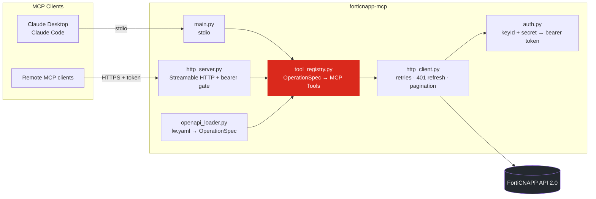

# 🛡️ forticnapp-mcp — FortiCNAPP MCP Server

**Expose FortiCNAPP (formerly Lacework) API 2.0 as typed, auth-aware tools for any MCP client**

[](https://www.python.org/)
[](https://modelcontextprotocol.io/)
[](https://www.fortinet.com/products/forticnapp)
[](#2️⃣-http-mode-sharedremote)
[](#-security)

[Overview](#-overview) • [Install](#-installation) • [Configure](#-configuration) • [stdio](#1️⃣-stdio-mode-local) • [HTTP](#2️⃣-http-mode-sharedremote) • [Architecture](#-architecture) • [Security](#-security) • [Tools](#-mcp-tools) • [Quick Reference](#-quick-reference)

---

## 📋 Overview

`forticnapp-mcp` is an MCP (Model Context Protocol) server for FortiCNAPP API 2.0. Tools are **not hand-written** — they are generated at startup from the Lacework swagger spec (`lw.yaml`), so the tool surface tracks whichever spec you point it at.

The same tool registry ships behind **two interchangeable transports**. Pick the one that matches how you run the server.

| #     | Transport                                | Entry point           | Process Model                         | Auth                                                           | Best For                                       |
| ----- | ---------------------------------------- | --------------------- | ------------------------------------- | -------------------------------------------------------------- | ---------------------------------------------- |
| **1** | **stdio** — JSON-RPC over stdin/stdout   | `forticnapp-mcp`      | Spawned per client, dies with it      | FortiCNAPP credentials from its own env                        | 💻 Claude Desktop, Claude Code (single client) |
| **2** | **Streamable HTTP** — `POST /mcp/`       | `forticnapp-mcp-http` | Long-running (bare metal or Docker)   | FortiCNAPP credentials **+** bearer token gating the endpoint  | ☁️ Shared server, multiple remote clients      |

> [!TIP]
> Choose **stdio** to run locally on your own machine. Choose **Streamable HTTP** to share the server across users, deploy to the cloud, or require centralized authentication.

> [!NOTE]
> **Tenancy:** each instance serves exactly **one FortiCNAPP account** in both modes. In HTTP mode, every caller holding the bearer token sees the same account — there is no per-client credential isolation.

Both modes share every other module (`config.py`, `openapi_loader.py`, `auth.py`, `http_client.py`, `tool_registry.py`). `http_server.py` only adds a Starlette app, a bearer-token gate and a `/healthz` endpoint in front of the same `mcp.server.lowlevel.Server` that `main.py` runs over stdio.

### 🤔 Why This Exists

FortiCNAPP's API 2.0 spec makes naive OpenAPI-to-tool generation unreliable:

| Spec quirk                                                        | How this server handles it                                           |
| ----------------------------------------------------------------- | -------------------------------------------------------------------- |
| No OpenAPI `securitySchemes` declared                             | Hardcodes the real FortiCNAPP keyId + secret → bearer token handshake |
| No `operationId` on any of the 120+ operations                    | Derives deterministic tool names from method + path                  |
| Read-only "search" endpoints mixed in with mutations on same verbs | Classifies "is this mutating" from the path shape, not the HTTP verb |

See `CLAUDE.md` for the full list of spec quirks the design accounts for.

---

## 📦 Installation

**Requires Python 3.11+**

```bash
pip install -e ".[dev]"
```

---

## ⚙️ Configuration

Credentials come from the FortiCNAPP/Lacework console (**Settings → API Keys**), which issues a **keyId** and a **secret** — both are required for the default auth mode.

### 🚀 Option A — Interactive setup (recommended)

Prompts for credentials, validates them against the real FortiCNAPP token endpoint, and writes `.env`, a portable `.mcp.json` and `.gitignore`.

```bash
forticnapp-mcp-setup
```

### ✍️ Option B — Manual

```bash
cp .env.example .env
# then fill in FORTICNAPP_API_BASE_URL, FORTICNAPP_KEY_ID, FORTICNAPP_API_SECRET
```

### 🔑 Key environment variables

| Variable                                                 | Purpose                                                                         |
| -------------------------------------------------------- | ------------------------------------------------------------------------------- |
| `FORTICNAPP_API_BASE_URL`                                | Tenant URL, e.g. `https://YourAccount.lacework.net`                             |
| `FORTICNAPP_KEY_ID`                                      | API key ID                                                                      |
| `FORTICNAPP_API_SECRET`                                  | API secret                                                                      |
| `FORTICNAPP_OPENAPI_SPEC`                                | Path to the spec (default `./lw.yaml`)                                          |
| `FORTICNAPP_ENABLED_TAGS`                                | Which OpenAPI tags become tools                                                 |
| `ENABLE_MUTATION_TOOLS`                                  | Opt in to mutating tools — **off by default**, only read-only tools are exposed |
| `FORTICNAPP_MCP_HTTP_TOKEN`                              | Bearer token protecting the HTTP endpoint *(HTTP mode only)*                    |
| `FORTICNAPP_MCP_HTTP_HOST` / `FORTICNAPP_MCP_HTTP_PORT` | HTTP bind address *(default `0.0.0.0:8000`)*                                    |

See `.env.example` for every supported variable.

---

## 1️⃣ stdio Mode (local)

The client (e.g. Claude Desktop) launches the server as a subprocess and talks JSON-RPC over its stdin/stdout.

```bash
forticnapp-mcp
# equivalently:
python -m forticnapp_mcp.main
```

The server validates configuration and loads the spec **before** it starts listening. On failure it exits with a clear one-line error on stderr — it will not start with a broken configuration. This is the default mode.

### 🖥️ Claude Desktop

Add to `claude_desktop_config.json`:

```json
{
  "mcpServers": {
    "forticnapp": {
      "command": "python",
      "args": ["-m", "forticnapp_mcp.main"],
      "cwd": "/absolute/path/to/mcp_forticnapp",
      "env": {
        "FORTICNAPP_API_BASE_URL": "https://YourAccount.lacework.net",
        "FORTICNAPP_KEY_ID": "YOUR_KEY_ID",
        "FORTICNAPP_API_SECRET": "YOUR_SECRET",
        "FORTICNAPP_OPENAPI_SPEC": "/absolute/path/to/mcp_forticnapp/lw.yaml"
      }
    }
  }
}
```

> [!IMPORTANT]
> `cwd` must be the project root so the default `FORTICNAPP_OPENAPI_SPEC=./lw.yaml` resolves — or set an absolute path as shown above.

> [!WARNING]
> Prefer a real `.env` file over inlining secrets in this config wherever your setup allows it.

---

## 2️⃣ HTTP Mode (shared/remote)

Use the `forticnapp-mcp-http` entry point for one server shared by multiple MCP clients. Every request to `/mcp` requires a bearer token (`FORTICNAPP_MCP_HTTP_TOKEN`) — a **separate secret** from your FortiCNAPP credentials, protecting the HTTP endpoint itself.

**Bare metal**

```bash
cp .env.example .env
# fill in FORTICNAPP_API_BASE_URL / KEY_ID / API_SECRET as usual, plus:
# FORTICNAPP_MCP_HTTP_TOKEN=<a long random secret>

forticnapp-mcp-http
# equivalently:
python -m forticnapp_mcp.http_server
```

**Docker**

```bash
docker compose up --build
```

### 🌐 Endpoints

| Endpoint        | Method | Auth                              | Purpose                                                                      |
| --------------- | ------ | --------------------------------- | ---------------------------------------------------------------------------- |
| `/mcp/`         | `POST` | `Authorization: Bearer <token>`   | MCP Streamable HTTP *(a bare `/mcp` without trailing slash 307-redirects)*   |
| `/healthz`      | `GET`  | None                              | Container `HEALTHCHECK`, load balancer and uptime checks                     |

The server listens on `0.0.0.0:8000` by default.

**Generic Streamable HTTP client config** *(shape varies by client)*

```json
{
  "mcpServers": {
    "forticnapp": {
      "type": "http",
      "url": "http://<host>:8000/mcp/",
      "headers": { "Authorization": "Bearer <FORTICNAPP_MCP_HTTP_TOKEN>" }
    }
  }
}
```

---

## 🏗️ Architecture



### 🧩 Modules

| Module              | Responsibility                                                                                                                                                      |
| ------------------- | ------------------------------------------------------------------------------------------------------------------------------------------------------------------- |
| `config.py`         | Env vars → validated `Settings` (pydantic-settings); fails fast                                                                                                     |
| `openapi_loader.py` | `lw.yaml`/json → `OperationSpec` list; resolves `$ref`/`allOf`, builds a pydantic input model per operation, infers the token endpoint's field names                |
| `auth.py`           | `ApiKeyAuthStrategy` / `BearerTokenStrategy` / `ApiKeyToTokenStrategy` — the last is FortiCNAPP's real keyId+secret → bearer token handshake                         |
| `http_client.py`    | `httpx.AsyncClient` wrapper: builds requests from validated arguments, retries network/5xx errors, retries once on 401 after refreshing auth, follows cursor pagination |
| `tool_registry.py`  | `OperationSpec` list → `mcp.types.Tool` list (resolving name collisions); dispatches `call_tool` requests to `http_client`                                          |
| `main.py`           | Wires the above into `mcp.server.lowlevel.Server` + `stdio_server`                                                                                                  |
| `http_server.py`    | Starlette app, bearer-token gate and `/healthz` in front of the same server                                                                                         |
| `models.py`         | `OperationSpec` / `OperationParameter` (internal) and the `ToolCallResult` / `RequestMeta` / `PaginationInfo` models every tool returns                             |
| `errors.py`         | `ForticnappError` hierarchy (auth / validation / api / network / spec), each carrying category, status_code, operation_id, retryable                                |
| `logging_utils.py`  | Structured JSON logs to stderr with header/secret redaction                                                                                                         |
| `utils.py`          | Tool-name derivation, mutation/pagination classification, JSON Schema → Python type mapping                                                                         |

### 📨 Tool response envelope

Every tool call returns the same structured JSON envelope:

```json
{
  "success": true,
  "status_code": 200,
  "operation_id": "forticnapp_alerts_list",
  "request": {"method": "GET", "path": "/api/v2/Alerts", "query_keys": ["startTime"], "has_body": false},
  "data": { "...": "..." },
  "pagination": {"rows": 50, "total_rows": 400, "next_page_url": "https://...", "has_more": true},
  "error": null
}
```

> [!TIP]
> **Pagination:** call the same tool again with `page_url` set to `pagination.next_page_url` from the previous response. Every other argument is ignored when `page_url` is set.

### 🔧 Customizing the token exchange

If your deployment's token endpoint differs from the documented contract (self-hosted, FedRAMP, a future API revision), there is exactly **one place to change**: `ApiKeyToTokenStrategy._acquire_token` in `auth.py`.

It builds the token request and parses the response using field names from a `TokenOperationHint`, inferred from the spec at startup (`openapi_loader.discover_token_operation`) with fallback defaults matching FortiCNAPP's current contract:

| Direction    | Fields                                         |
| ------------ | ---------------------------------------------- |
| **Request**  | `keyId`, `expiryTime` — secret in `X-LW-UAKS`  |
| **Response** | `token`, `expiresAt`                           |

Token caching, proactive refresh and 401-triggered re-acquisition are wire-format-agnostic and live in the surrounding `ApiKeyToTokenStrategy` methods — you shouldn't need to touch them.

---

## 🛡️ Security

| Control                       | Behavior                                                                                                                              |
| ----------------------------- | ------------------------------------------------------------------------------------------------------------------------------------- |
| 🧠 **In-memory secrets**      | Tokens and secrets are kept in memory only; nothing is persisted to disk                                                              |
| 🙈 **Log redaction**          | `redact_headers()` / `redact_secret()` wrap every header dict or secret reaching a log call — `Authorization`, `X-LW-UAKS` and cookie headers are never logged in full |
| 🔒 **Read-only by default**   | Mutating operations (anything that isn't a `GET` or `POST .../search`) are excluded unless `ENABLE_MUTATION_TOOLS=true`               |
| 🎫 **Endpoint gate (HTTP)**   | Every `/mcp` request requires `FORTICNAPP_MCP_HTTP_TOKEN`                                                                             |
| 👥 **Shared account (HTTP)**  | No per-client credential isolation — all callers share the same FortiCNAPP account                                                    |

> [!CAUTION]
> **Never commit API keys, secrets or the HTTP bearer token to Git.** Keep `.env` out of source control:
>
> ```gitignore
> .env
> .mcp.json
> ```

---

## 🧰 MCP Tools

**37 read-only tools** across 9 categories.

> Prefix: `mcp__remote-devices__forticnapp__` — each name below is prefixed with this. The server also appeared earlier under `mcp__claude-device__lcl-forticnapp-`.

| Category                     | Tools |
| ---------------------------- | :---: |
| 🚨 Alerts                    |   5   |
| ☁️ Cloud accounts            |   4   |
| 🖧 Entities                  |  14   |
| 📅 Events                    |   1   |
| 📋 Inventory                 |   2   |
| 📜 Policies                  |   4   |
| 📊 Reports                   |   1   |
| 🐞 Vulnerabilities           |   3   |
| 🛑 Vulnerability exceptions  |   3   |
| **Total**                    | **37** |

<details>
<summary><b>🚨 Alerts (5)</b></summary>

- `forticnapp_alerts_list`
- `forticnapp_alerts_get`
- `forticnapp_alerts_search`
- `forticnapp_alerts_entities_get`
- `forticnapp_alerts_entity_details_get`

</details>

<details>
<summary><b>☁️ Cloud accounts (4)</b></summary>

- `forticnapp_cloud_accounts_list`
- `forticnapp_cloud_accounts_search`
- `forticnapp_cloud_accounts_by_type_get`
- `forticnapp_cloud_accounts_by_intg_guid_get`

</details>

<details>
<summary><b>🖧 Entities (14)</b></summary>

- `forticnapp_entities_machines_search`
- `forticnapp_entities_machine_details_search`
- `forticnapp_entities_containers_search`
- `forticnapp_entities_images_search`
- `forticnapp_entities_k8s_pods_search`
- `forticnapp_entities_applications_search`
- `forticnapp_entities_packages_search`
- `forticnapp_entities_processes_search`
- `forticnapp_entities_command_lines_search`
- `forticnapp_entities_files_search`
- `forticnapp_entities_new_file_hashes_search`
- `forticnapp_entities_users_search`
- `forticnapp_entities_network_interfaces_search`
- `forticnapp_entities_internal_ip_addresses_search`

</details>

<details>
<summary><b>📅 Events (1) · 📋 Inventory (2) · 📊 Reports (1)</b></summary>

- `forticnapp_events_search`
- `forticnapp_inventory_search`
- `forticnapp_inventory_scan_list`
- `forticnapp_reports_list`

</details>

<details>
<summary><b>📜 Policies (4)</b></summary>

- `forticnapp_policies_list`
- `forticnapp_policies_get`
- `forticnapp_policies_search`
- `forticnapp_policies_tags_list`

</details>

<details>
<summary><b>🐞 Vulnerabilities (3) · 🛑 Vulnerability exceptions (3)</b></summary>

- `forticnapp_vulnerabilities_hosts_search`
- `forticnapp_vulnerabilities_containers_search`
- `forticnapp_vulnerabilities_containers_scan_get`
- `forticnapp_vulnerability_exceptions_list`
- `forticnapp_vulnerability_exceptions_get`
- `forticnapp_vulnerability_exceptions_search`

</details>

---

## 🧪 Development

```bash
ruff check src/
pytest
```

---

## ⚡ Quick Reference

**stdio (local)**

```bash
pip install -e ".[dev]"
forticnapp-mcp-setup      # interactive credentials + .env + .mcp.json
forticnapp-mcp            # launched by the MCP client as a subprocess
```

**HTTP (shared)**

```bash
cp .env.example .env      # set FORTICNAPP_* and FORTICNAPP_MCP_HTTP_TOKEN
docker compose up --build
curl http://<host>:8000/healthz
```

**Client call**

```http
POST http://<host>:8000/mcp/
Authorization: Bearer <FORTICNAPP_MCP_HTTP_TOKEN>
```

---

🔒 Keep secrets out of source control · Mutations are opt-in · Rotate API keys regularly
